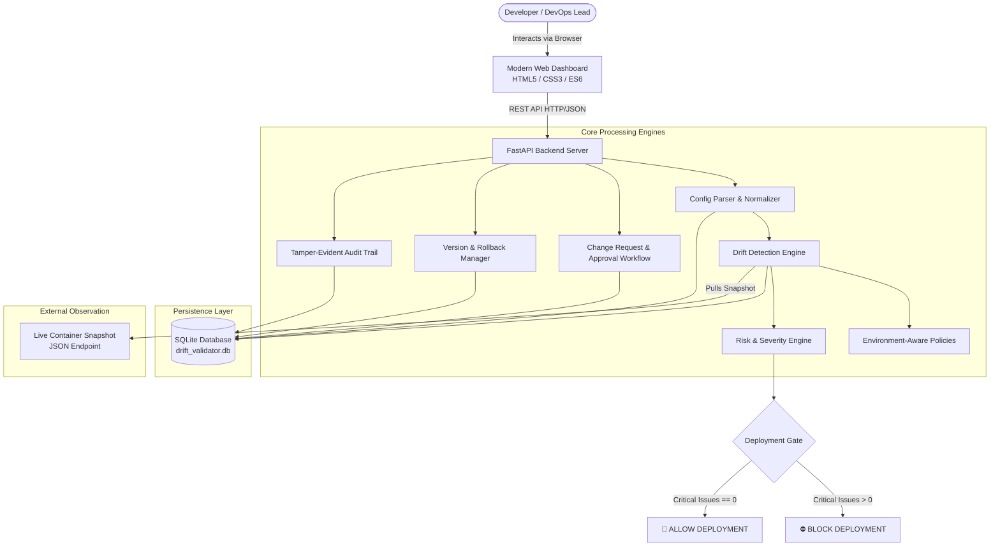
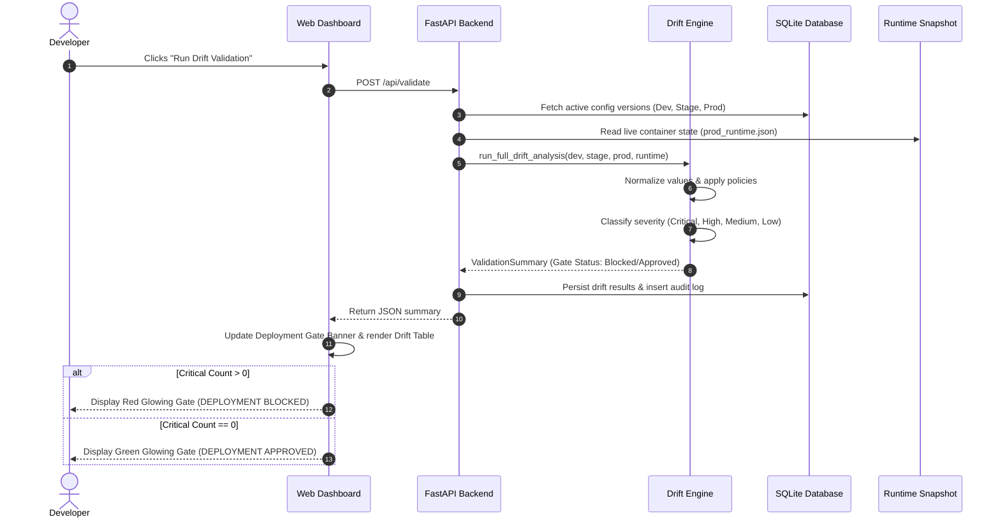

# System Architecture - Configuration Drift Validator

## 1. Overview
The **Configuration Drift Validator** is an automated safety gate designed to prevent environment-specific configuration mistakes (such as debug flags, test database pointers, unrotated secrets, or missing health checks) from reaching production environments.

---

## 2. High-Level Architecture Diagram

---

## 3. Component Breakdown

### 3.1 Web Dashboard (Frontend)
- **Technology:** Vanilla HTML5, Custom CSS3 Design System with Dark-Theme Glassmorphism, Modular JavaScript.
- **Key Modules:**
  - **Deployment Gate Banner:** Real-time visual indicator displaying whether production deployment is allowed or blocked, along with specific blockers.
  - **Environment Health Cards:** Summary cards showing active versions, database host, and debug flags for Development, Staging, and Production.
  - **Interactive Drift Table:** Displays severity, environment, category, expected value, actual value, and remediation action.
  - **Configuration Manager:** In-browser code editor for `.env`, YAML manifests, and Secret metadata with 1-click save.
  - **Change Approval Console:** Peer review queue where changes are evaluated and approved before application.
  - **Rollback Manager:** 1-click restoration to any previous version.
  - **Audit Log Viewer:** Real-time log stream of all events.
  - **College Viva Scenarios Panel:** Instant injection buttons for examiner demonstration.

### 3.2 FastAPI REST Backend
- **Endpoints:**
  - `/api/environments`: Environment metadata and active version tracking.
  - `/api/configs/{env}`: Fetching and versioned updating of configuration bundles.
  - `/api/validate`: Initiates multi-tier drift detection across all layers.
  - `/api/deployment-gate`: Provides gate status for CI/CD pipelines.
  - `/api/change-requests`: Creation, review, and automated merge upon approval.
  - `/api/rollback`: Safe restoration of prior configuration snapshots.
  - `/api/audit-logs`: Querying tamper-evident activity history.

### 3.3 Normalizer & Sanitizer (`normalizer.py`)
- Sanitizes incoming input to prevent false positives and resist adversarial bypasses:
  - Strips leading/trailing whitespace and outer quotation marks (`"true"` vs `true`).
  - Coerces truthy/falsy strings (`yes`, `1`, `true`, `True` -> `True`).
  - Coerces numeric strings (`"5432"` -> `5432`).
  - Normalizes database connection strings by extracting hostnames.

### 3.4 Environment-Aware Policy Engine (`validation_policy.py`)
- Employs heuristics that distinguish **expected variations** from **dangerous drift**:
  - `APP_ENV`: Naturally differs (`development`, `staging`, `production`).
  - `DATABASE_HOST`: `dev-db` in dev vs `staging-db` in staging vs `prod-db` in prod is **expected**.
  - `DATABASE_HOST`: `dev-db` in production is a **CRITICAL** violation.

### 3.5 Risk & Severity Classifier (`risk_engine.py`)
- Classifies each discrepancy into one of four deterministic tiers:
  - **CRITICAL:** Debug enabled in prod, dev database/API in prod, missing production secret.
  - **HIGH:** Missing required environment variable, container runtime drift, disabled health checks.
  - **MEDIUM:** Unrotated secret (> 90 days), log level mismatch, insufficient replicas (< 2).
  - **LOW:** Minor metadata or formatting variances.

### 3.6 Secret Metadata Abstraction
- Guarantees zero credential leakage:
  - Stores only metadata: name, source, exists, last_rotated, age_days.
  - Never stores or displays raw tokens, API keys, or database passwords.

### 3.7 Cryptographic Authentication & RBAC Engine (auth.py)
- Enforces defense-in-depth:
  - **OWASP-Compliant Passwords:** Salted PBKDF2-HMAC-SHA256 hashes with 100,000 iterations and 16-byte cryptographically secure random salts.
  - **RFC 7519 Signed JWTs:** Uses HMAC-SHA256 signatures with 120-minute expiration.
  - **Three-Tier RBAC:** Admin (Rollback, Approvals), Developer (Uploads, Changes, Drift Validation), Viewer (Read-only status & reports).
  - **Zero Identity Trust:** Identities recorded in audit logs and rollback records are bound to cryptographic token claims, preventing client spoofing.

- Guarantees zero credential leakage:
  - Stores only metadata: `name`, `source`, `exists`, `last_rotated`, `age_days`.
  - Never stores or displays raw tokens, API keys, or database passwords.

---

## 4. Sequence of Operations: Deployment Gate Verification

