# Database Schema Documentation — Configuration Drift Validator

This document provides complete technical documentation for the SQLite persistence layer implemented in `backend/database.py`.

The database engine uses SQLite 3 with Foreign Key enforcement (`PRAGMA foreign_keys = ON`) and stores data in a single local database file (`drift_validator.db`).

---

## 1. Entity-Relationship (ER) Diagram

```mermaid
erDiagram
    ENVIRONMENTS ||--o{ CONFIGURATION_VERSIONS : "contains"
    ENVIRONMENTS ||--o{ ENVIRONMENT_VARIABLES : "declares"
    ENVIRONMENTS ||--o{ INFRASTRUCTURE_DEFINITIONS : "defines"
    ENVIRONMENTS ||--o{ SECRET_METADATA : "tracks"
    ENVIRONMENTS ||--o{ RUNTIME_SNAPSHOTS : "snapshots"
    ENVIRONMENTS ||--o{ CHANGE_REQUESTS : "targets"
    ENVIRONMENTS ||--o{ ROLLBACK_RECORDS : "records"
    VALIDATION_RUNS ||--o{ DRIFT_RESULTS : "contains"
    ENVIRONMENTS ||--o{ DEPLOYMENT_CHECKS : "gates"
    ENVIRONMENTS ||--o{ MONITORING_EVENTS : "monitors"

    ENVIRONMENTS {
        int id PK
        string name UK
        string display_name
        string status
        timestamp created_at
        timestamp updated_at
    }

    CONFIGURATION_VERSIONS {
        int id PK
        int environment_id FK
        string key
        string value
        string value_type
        int version
        int is_active
        string source
        timestamp created_at
        string created_by
    }

    ENVIRONMENT_VARIABLES {
        int id PK
        int environment_id FK
        string key
        string value
        int is_secret
        int version
        int is_active
        timestamp created_at
    }

    INFRASTRUCTURE_DEFINITIONS {
        int id PK
        int environment_id FK
        string service_name
        int port
        int replicas
        string memory
        string cpu
        int health_check
        int is_active
        timestamp created_at
    }

    SECRET_METADATA {
        int id PK
        int environment_id FK
        string name
        int exists_flag
        string source
        date last_rotated
        int rotation_policy_days
        timestamp created_at
    }

    RUNTIME_SNAPSHOTS {
        int id PK
        int environment_id FK
        string snapshot_json
        string app_version
        timestamp captured_at
    }

    VALIDATION_RUNS {
        int id PK
        string run_id UK
        string target_environment
        string compared_against
        int total_issues
        int critical_count
        int high_count
        int medium_count
        int low_count
        int deployment_allowed
        timestamp created_at
    }

    DRIFT_RESULTS {
        int id PK
        string run_id FK
        int environment_id FK
        string category
        string config_key
        string expected_value
        string actual_value
        string severity
        string reason
        string recommended_action
        int is_expected_difference
        timestamp created_at
    }

    CHANGE_REQUESTS {
        int id PK
        int environment_id FK
        string config_key
        string old_value
        string new_value
        string risk_level
        string status
        string requested_by
        string justification
        string reviewed_by
        timestamp created_at
        timestamp reviewed_at
    }

    ROLLBACK_RECORDS {
        int id PK
        int environment_id FK
        string config_key
        int from_version
        int to_version
        string from_value
        string to_value
        string rolled_back_by
        timestamp created_at
    }

    AUDIT_LOGS {
        int id PK
        timestamp timestamp
        string user
        string action
        string environment
        string details
        string result
        string risk_level
    }

    GIT_COMMITS {
        int id PK
        string commit_hash UK
        string message
        string author
        string branch
        string files_changed
        timestamp created_at
    }

    NOTIFICATIONS {
        int id PK
        string title
        string message
        string severity
        int is_read
        timestamp created_at
    }

    DEPLOYMENT_CHECKS {
        int id PK
        int environment_id FK
        string run_id
        string status
        int blocking_issues
        timestamp created_at
    }

    MONITORING_EVENTS {
        int id PK
        int environment_id FK
        string event_type
        string details
        string severity
        timestamp created_at
    }
```



---

## 2. Table-by-Table Technical Specifications

### Table 1: `environments`
- **Purpose**: Stores top-level deployment environments (`development`, `staging`, `production`) and tracks operational health.
- **Columns**:
  - `id` (`INTEGER PRIMARY KEY AUTOINCREMENT`)
  - `name` (`TEXT UNIQUE NOT NULL`)
  - `display_name` (`TEXT NOT NULL`)
  - `status` (`TEXT DEFAULT 'healthy'`)
  - `created_at`, `updated_at` (`TIMESTAMP DEFAULT CURRENT_TIMESTAMP`)

### Table 2: `configuration_versions`
- **Purpose**: Key-value configuration entries with monotonic versioning. Old versions remain with `is_active = 0` to enable historical auditing and deterministic rollback.
- **Columns**:
  - `id` (`INTEGER PRIMARY KEY AUTOINCREMENT`)
  - `environment_id` (`INTEGER NOT NULL`, FK to `environments(id)`)
  - `key` (`TEXT NOT NULL`)
  - `value` (`TEXT`)
  - `value_type` (`TEXT DEFAULT 'string'`)
  - `version` (`INTEGER DEFAULT 1`)
  - `is_active` (`INTEGER DEFAULT 1`)
  - `source` (`TEXT DEFAULT 'manual'`)
  - `created_at` (`TIMESTAMP DEFAULT CURRENT_TIMESTAMP`)
  - `created_by` (`TEXT DEFAULT 'system'`)

### Table 3: `environment_variables`
- **Purpose**: Tracks OS-level environment variables per environment.
- **Columns**: `id`, `environment_id` (FK), `key`, `value`, `is_secret`, `version`, `is_active`, `created_at`.

### Table 4: `infrastructure_definitions`
- **Purpose**: Stores service infrastructure definitions (replicas, ports, memory, health checks).
- **Columns**: `id`, `environment_id` (FK), `service_name`, `port`, `replicas`, `memory`, `cpu`, `health_check`, `is_active`, `created_at`.

### Table 5: `secret_metadata`
- **Purpose**: Tracks metadata *about* secrets (existence, source, rotation timestamp, policy duration) **without storing raw secret values**, adhering to security compliance standards.
- **Columns**: `id`, `environment_id` (FK), `name`, `exists_flag`, `source`, `last_rotated`, `rotation_policy_days`, `created_at`.

### Table 6: `runtime_snapshots`
- **Purpose**: Ingests point-in-time state of active processes to detect runtime drift between running containers and static configuration files.
- **Columns**: `id`, `environment_id` (FK), `snapshot_json`, `app_version`, `captured_at`.

### Table 7: `validation_runs`
- **Purpose**: Summarizes each validation run with aggregated counts and release gate decisions.
- **Columns**: `id`, `run_id` (UNIQUE), `target_environment`, `compared_against`, `total_issues`, `critical_count`, `high_count`, `medium_count`, `low_count`, `deployment_allowed`, `created_at`.

### Table 8: `drift_results`
- **Purpose**: Detailed records of every drift discrepancy identified during validation runs.
- **Columns**: `id`, `run_id`, `environment_id` (FK), `category`, `config_key`, `expected_value`, `actual_value`, `severity`, `reason`, `recommended_action`, `is_expected_difference`, `created_at`.

### Table 9: `change_requests`
- **Purpose**: Manages configuration change proposals, enforcing peer review for high-risk updates.
- **Columns**: `id`, `environment_id` (FK), `config_key`, `old_value`, `new_value`, `risk_level`, `status`, `requested_by`, `justification`, `reviewed_by`, `created_at`, `reviewed_at`.

### Table 10: `rollback_records`
- **Purpose**: Maintains an immutable log of rollback operations, recording from-version, to-version, and previous values restored.
- **Columns**: `id`, `environment_id` (FK), `config_key`, `from_version`, `to_version`, `from_value`, `to_value`, `rolled_back_by`, `created_at`.

### Table 11: `audit_logs`
- **Purpose**: Immutable security audit trail recording all platform operations, actions, users, and risk tiers.
- **Columns**: `id`, `timestamp`, `user`, `action`, `environment`, `details`, `result`, `risk_level`.

### Auxiliary Tables (Tables 12-16)
- `git_commits`: Simulated git commit log for pre-deployment CI hooks.
- `notifications`: In-app notification alerts for drift and gate status.
- `deployment_checks`: Historic log of automated deployment gate decisions.
- `monitoring_events`: Background drift scanner event log.
- `users`: Registered accounts, salted PBKDF2 password hashes, and assigned RBAC roles (`admin`, `developer`, `viewer`) for cryptographic JWT authentication.

---

## 3. Database Initialization & Reset Procedure

The database is initialized automatically on FastAPI startup via `lifespan` in `backend/main.py`.

To reset the database to a clean, reproducible state with sample seed data via API:
```powershell
# Using curl or PowerShell:
Invoke-RestMethod -Method Post -Uri "http://localhost:8000/api/reset-demo"
```
Or programmatically via python:
```python
from backend.database import init_db
from backend.main import seed_sample_configs_if_needed
init_db()
seed_sample_configs_if_needed()
```
